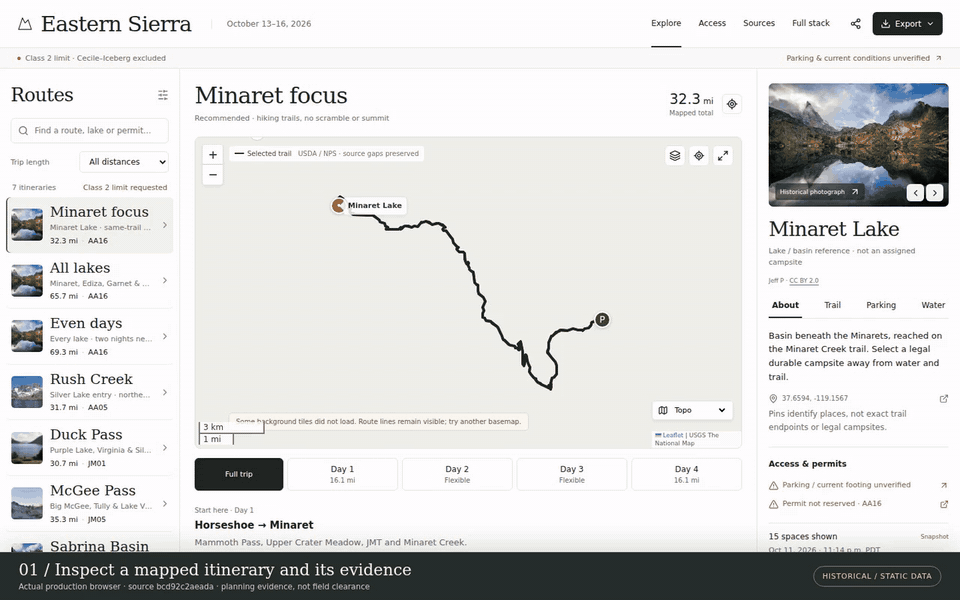
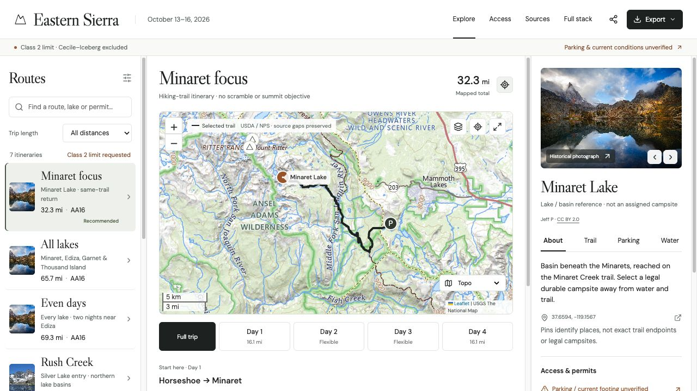

# backpacking-eastern-sierra

An inspectable Eastern Sierra backpacking atlas: real agency trail geometry, seven selectable itineraries, daily and individual-leg inspection, topo/satellite/street maps, licensed place photos, and evidence-based permit/parking checks.



[Watch the MP4 demo](docs/demo/atlas-demo.mp4) · actual local production browser at source `2c0dbfd79f4f0a2ef94a23acb5a0a21d566f68b8`

The recording exercises route/day/leg inspection, licensed historical photography, map layers, access evidence, a real GPX export and source provenance. Its permit counts are an October 11, 2026 historical snapshot: nothing was reserved, paid for or issued. Parking, road access, current trail conditions and the requested Class 2 ceiling remain unverified.



## Run locally

Requires Node.js 22+ and npm.

```sh
npm ci
npm run dev
```

Open http://127.0.0.1:5173/. No API key or backend account is required.

```sh
npm test           # data contracts, route integrity, GPX and evidence regression checks
npm run validate  # every route reference, coordinate, daily distance and return-to-start
npm run build     # TypeScript checks and optimized production assets
npm run preview   # serve the production build at http://127.0.0.1:4173/
npm run browser:e2e # real desktop/mobile production-preview journeys
npm run demo:verify # demo source guard, artifact hashes and browser receipt
```

## Explore

1. Choose a route in the left rail (on mobile, **Change route**). Search by lake, area or permit code; filter by trip length.
2. Use **Full trip** or a day button to fit the map and show directions. Click a trail leg to highlight and inspect it.
3. Click a place pin or photo strip to inspect real photos, water expectations and parking. Peak pins are scenic references; no summit route is included.
4. Use **Access** before departure. **Sources** shows provenance; **Full stack** explains how the app works.
5. Export GPX, GeoJSON or directions/evidence. GPX preserves separate source segments rather than connecting mapping gaps. Route/day state is shareable in the URL.

## What the evidence supports

Seven routes are selectable. The direct Minaret–Cecile–Iceberg scramble is excluded under the requested Class 2 maximum. Sabrina's uncertain Baboon branch is also omitted; its default is now **17.0 mapped miles**, before the overnight-parking road walk. Default Minaret focus is **32.3 mapped miles** on the Mammoth Pass/Upper Crater Meadow/JMT approach.

Agency geometry establishes a mapped trail itinerary, **not a certified current Class 2 ceiling**. No route has calculated cumulative ascent. Snow, ice, creek crossings, obstacles and camping detours can change feasibility. Place pins identify basins, not legal campsites.

Permit counts are explicitly **historical snapshots checked October 11, 2026, 11:14 p.m. PDT** for October 13 and one person. No permit has been reserved, paid for or issued. Recreation.gov is the authoritative live booking surface.

Overnight Horseshoe parking and current Lake Mary Road access remain unconfirmed. Current 2026 road order closes Reds Meadow Road and a 200-foot corridor on weekdays. GIS comparison puts the mapped common approach about 342m from the main road at its closest point; this supports avoiding that corridor, without establishing parking or field clearance.

Full detail: [route evidence](docs/ROUTE_EVIDENCE.md), [architecture](docs/ARCHITECTURE.md), [design](docs/DESIGN.md), [verification](docs/VERIFICATION.md).

## Stack and deployment

React19 + TypeScript + Vite; Leaflet cartography; versioned JSON/GeoJSON; local licensed JPEGs. The production app is a static client. Basemap tiles and optional Google Fonts need network access; font fallback and route geometry remain local. No payment, credential, secret key or paid-model integration is present. Personal checklist notes stay in browser localStorage and are never agency verification.

The repository includes CI and an optional manual GitHub Pages workflow. `base: './'` supports a repository subpath. Pages deployment must be enabled in repository settings before running the manual workflow. A local build is not proof of hosted deployment.

## Data and licenses

Trail lines: USDA Forest Service National Forest System Trails and NPS Public Trails, retrieved October11,2026. Photos are historical Wikimedia Commons works, with author, license and source links in the UI and `public/data/photos.json`. Photo licenses remain with their authors. No generated scenery is presented as real evidence. See [THIRD_PARTY.md](THIRD_PARTY.md).

`public/data/` contains runtime planning data. `scripts/legacy-*.js` preserves the source-content migration context; `scripts/normalize.mjs` is historical migration tooling and is not a routine data-refresh command. Refresh production JSON deliberately and rerun validation before publishing.
