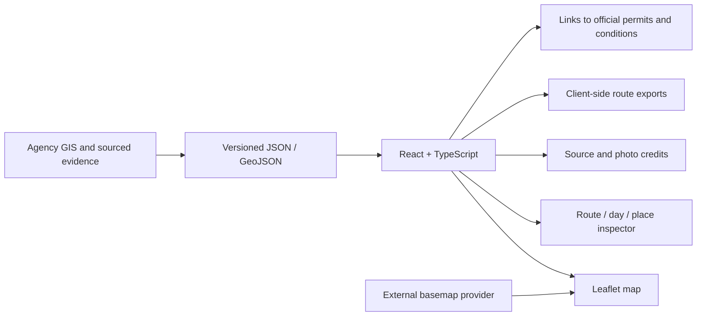

# Application architecture

## Scope

The stack is **React + TypeScript + Vite**, with plain **Leaflet** managed through React effects and static JSON/GeoJSON for routes, places, photos and evidence. It is a local-first planning application that builds into static assets. There is no application backend, account database, live permit synchronization or reservation automation. Publishing the site does not certify trail access or field conditions.

## Data contracts

- `public/data/routes.json` holds seven route IDs, permit entry, approximate distance, day summaries and route-line feature references. Route IDs are stable. Cecile is absent from production route JSON; legacy scripts are archival context, not runtime inputs. Sabrina excludes Baboon and has a flexible third day.
- `route-lines.geojson` holds actual highlighted agency trail polylines. Feature IDs connect map geometry to itinerary days. Missing geometry on flexible base days is intentional; do not fabricate a track to fill the view.
- `trails.geojson` holds the regional agency trail context. Background lines are mapped inventory, not permission or current passability.
- `places.json` holds approximate feature locations, descriptions, water caveats and photo references. A place is not a guaranteed campsite.
- `photos.json` preserves image origin, author, license, source page and historical-condition caveat.
- Permit and access observations must retain checked time, date, group size, source and reservation state. Historical evidence must never silently become a live availability badge.

The build must validate that selected routes reference existing features, coordinates are finite and geographically sensible, exported files match selected routes, and attribution remains present. Distances should be labeled approximate; no cumulative ascent or universal Class 2 certification should be inferred from GeoJSON alone.

Leaflet initialization and layer updates live in React effects. Effects must remove obsolete layers, listeners and the map instance on cleanup so navigation and development remounts do not duplicate controls or leak state. No React-Leaflet wrapper or server rendering dependency is required.

## Interaction model

Maintain one coherent route selection and one optional day/place selection. Route changes reset incompatible day and place state. The map, day list, distance summary, permit entry and inspector must update together. Provide explicit fit-route and full-trip actions so panning or granular inspection is easy to reverse.

Use persistent, visible controls for essential actions. Hover adds preview information; keyboard focus and touch must expose the same useful detail. Tooltips should not cover map controls or become the sole place for an access warning. Route choice, day choice, map layers and close/back controls need accessible names, visible focus and generous targets. On small screens, stack the inspector and map without clipping controls or creating horizontal scroll.

The local map owns the planned hiking geometry. Google Maps links may help inspect places or road approaches but must not replace the agency hiking route with an independently generated walking route. Do not present a Google driving or walking result as proof of wilderness passage.

## Runtime and deployment boundaries

Vite serves the local application and creates static production assets. Photos and route data can be packaged locally; basemap tiles and official source links still need network access. A loaded map is not an offline navigation product. Basemap providers require attribution and may impose usage limits; retain attribution and review provider terms before public traffic grows.

Use no secrets in client code, Git history or `VITE_*` variables; those variables are bundled for public viewing. The application needs no Recreation.gov credentials. Users complete permit booking on the official service. Do not scrape logged-in accounts or store payment details.

A reproducible release needs a lockfile, documented install/build/preview commands, a successful TypeScript/build check, and browser journeys covering every selectable route, days, place inspection, layers, mobile layout and exports. Report the checks actually run. Source review, build success, browser behavior and field/legal clearance are separate evidence states. Any future deployment, live permit integration or backend must document its own credentials, validation and operational scope rather than being implied by this static architecture.

See [ROUTE_EVIDENCE.md](ROUTE_EVIDENCE.md) for route provenance and unresolved trip logistics.
